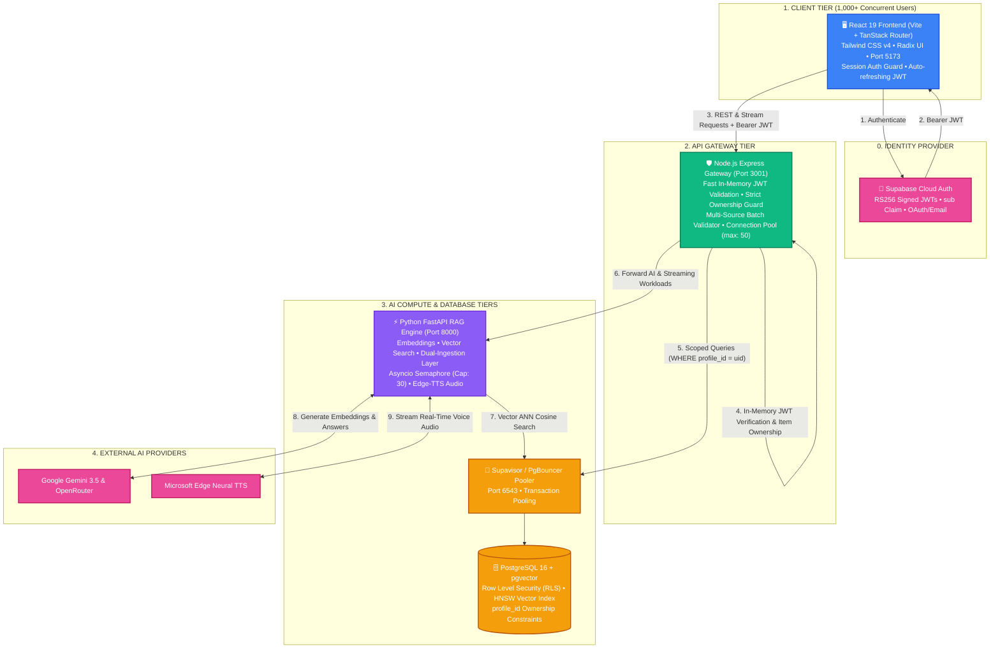
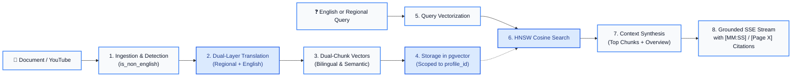

#  LearnX — System Architecture & Enterprise Scaling Specification

> **Ultra Learn*UI[\"🖥️ React 19 Frontend (Vite + TanStack Router)\u003Cbr/>Tailwind CSS v4 • Radix UI • Port 5173\u003Cbr/>Session Auth Guard • Auto-refreshing JWT\"]:::client* is an AI-powered personalized study assistant that unifies multi-source synthesis (NotebookLM-style) with active recall (flashcards, auto-generated quizzes, Socratic chat, and multi-speaker audio podcasts).

---

## 1. High-Level System Architecture (C4 Component Model)



---

## 2. Multi-Tenancy & Authorization Security Model (Zero Data Leakage)

To guarantee that each user can **only access notebooks, knowledge sources, and RAG context created by themselves**, security is enforced at three distinct layers:

```
+─────────────────────────────────────────────────────────────────────────────+
| LAYER 1: CLIENT ROUTE GUARDS & API ATTACHER                                 |
| - TanStack Router checks active session on every navigation.                |
| - Unauthenticated visitors are automatically redirected to `/signin`.       |
| - `fetchWithAuth` attaches `Authorization: Bearer <JWT>` to every request.  |
+──────────────────────────────────────┬──────────────────────────────────────+
                                       │
                                       ▼
+─────────────────────────────────────────────────────────────────────────────+
| LAYER 2: GATEWAY OWNERSHIP & BATCH ID VALIDATION                            |
| - Node.js extracts `req.user.id` from cryptographic JWT claims.             |
| - Single-item endpoints verify `profile_id === req.user.id`.                |
| - Multi-Source RAG: Validates EVERY ID in `selectedSourceIds` against       |
|   `SELECT id FROM study_items WHERE id = ANY($1) AND profile_id = $2`.       |
|   Any foreign ID triggers an immediate 403 Forbidden rejection.             |
+──────────────────────────────────────┬──────────────────────────────────────+
                                       │
                                       ▼
+─────────────────────────────────────────────────────────────────────────────+
| LAYER 3: POSTGRESQL ROW LEVEL SECURITY (RLS) & DB CONSTRAINTS                |
| - `ALTER TABLE public.study_items ENABLE ROW LEVEL SECURITY;`               |
| - `CREATE POLICY study_items_owner ON public.study_items                    |
|     USING (profile_id = auth.uid()) WITH CHECK (profile_id = auth.uid());`  |
| - Foreign key cascades (`ON DELETE CASCADE`) prevent orphaned child rows.   |
+─────────────────────────────────────────────────────────────────────────────+
```

### Eliminating Shared Global Rows (`profile_id IS NULL`)
In earlier development versions, mock tutorial items were stored with `profile_id IS NULL`. Under this production architecture:
1. Every query strictly uses `WHERE profile_id = $1` (zero `OR profile_id IS NULL` bypasses).
2. When a new user signs up, the system provisions their own private, isolated copy of the introductory starter notebook.
3. No user can ever see, vector-search, or modify another user's content.

---

## 3. 1,000+ Concurrent Users Scaling Blueprint

Scaling to 1,000 to 2,000 concurrent active users requires addressing four critical bottlenecks:

### 1. Database Connection Scaling (Transaction Pooling)
- **Problem**: PostgreSQL forks a backend process per client connection. 1,000 direct connections would exhaust operating system file descriptors and crash Postgres (`max_connections = 100-200`).
- **Solution**: Connect via **Supabase Transaction Pooler (Supavisor / PgBouncer)** on port `6543`.
- Configure Node.js `pg.Pool` to `max: 30-50` connections per worker process with `idleTimeoutMillis: 30000` and `connectionTimeoutMillis: 5000`. Thousands of concurrent client requests share a small, resilient pool of database sockets.

### 2. High-Speed Vector Retrieval (HNSW Indexing)
- **Problem**: Sequential vector scans (`ORDER BY embedding <=> query_vec`) take $O(N)$ time, degrading retrieval latency to 300–800ms when thousands of documents are ingested.
- **Solution**: Implement **Hierarchical Navigable Small World (HNSW)** indexing:
  ```sql
  CREATE INDEX IF NOT EXISTS idx_document_chunks_embedding
    ON public.document_chunks
    USING hnsw (embedding vector_cosine_ops)
    WITH (m = 16, ef_construction = 64);
  ```
  Combined with `idx_document_chunks_item(item_id)`, retrieval latency remains **< 15ms** even with 500,000+ chunks.

### 3. AI Concurrency Throttling & Rate Limiting
- **Problem**: 1,000 users querying Gemini at the same moment would trigger HTTP `429 (Too Many Requests)` rate-limit locks.
- **Solution**:
  - FastAPI implements an `asyncio.Semaphore(30)` to cap concurrent external LLM requests, smoothly queueing excess queries.
  - Active model failover: `gemini-3.5-flash` $\rightarrow$ `gemini-flash-lite-latest` $\rightarrow$ `gemini-3.5-flash-lite` $\rightarrow$ `openrouter/gemini-2.5-flash`.
  - Server-Sent Events (SSE) streaming ensures users see the first token within ~300ms, maintaining immediate perceived responsiveness.

### 4. High-Performance In-Memory JWT Validation
- **Problem**: Calling remote `supabase.auth.getUser(token)` over HTTP for every incoming API request adds 50–150ms of network latency per hit.
- **Solution**: Decode and verify Supabase JWTs locally in-memory using asymmetric public key / secret verification (`jsonwebtoken`), reducing auth latency to **< 1ms**.

---

## 4. Multi-Source RAG with Cross-Lingual Translation (Option 2)



---

## 5. Complete Database Schema with RLS Policies (`db/init.sql`)

```sql
-- 1. Enable pgvector
CREATE EXTENSION IF NOT EXISTS vector;

-- 2. User Profiles
CREATE TABLE IF NOT EXISTS public.profiles (
  id UUID PRIMARY KEY REFERENCES auth.users(id) ON DELETE CASCADE,
  email TEXT UNIQUE NOT NULL,
  display_name TEXT,
  avatar_url TEXT,
  created_at TIMESTAMPTZ NOT NULL DEFAULT now(),
  updated_at TIMESTAMPTZ NOT NULL DEFAULT now()
);

-- 3. Study Items (Notebooks & Sources)
CREATE TABLE IF NOT EXISTS public.study_items (
  id UUID PRIMARY KEY DEFAULT gen_random_uuid(),
  profile_id UUID NOT NULL REFERENCES auth.users(id) ON DELETE CASCADE,
  notebook_id UUID REFERENCES public.study_items(id) ON DELETE CASCADE,
  title TEXT NOT NULL,
  kind TEXT NOT NULL,              -- 'notebook', 'pdf', 'youtube', 'website', 'text', 'research'
  file_name TEXT,
  content TEXT,
  youtube_url TEXT,
  video_id TEXT,
  notes TEXT NOT NULL DEFAULT '',
  chapters JSONB DEFAULT '[]'::jsonb,
  transcript JSONB DEFAULT '[]'::jsonb,
  briefing_doc TEXT,
  audio_script JSONB,
  file_data BYTEA,
  created_at TIMESTAMPTZ NOT NULL DEFAULT now()
);

-- 4. Document Chunks (pgvector Embeddings)
CREATE TABLE IF NOT EXISTS public.document_chunks (
  id UUID PRIMARY KEY DEFAULT gen_random_uuid(),
  item_id UUID NOT NULL REFERENCES public.study_items(id) ON DELETE CASCADE,
  page_number INT NOT NULL DEFAULT 1,
  chunk_text TEXT NOT NULL,
  embedding vector(1536)
);

-- 5. Flashcards
CREATE TABLE IF NOT EXISTS public.flashcards (
  id UUID PRIMARY KEY DEFAULT gen_random_uuid(),
  item_id UUID NOT NULL REFERENCES public.study_items(id) ON DELETE CASCADE,
  question TEXT NOT NULL,
  answer TEXT NOT NULL,
  hint TEXT,
  created_at TIMESTAMPTZ NOT NULL DEFAULT now()
);

-- 6. Quizzes
CREATE TABLE IF NOT EXISTS public.quizzes (
  id UUID PRIMARY KEY DEFAULT gen_random_uuid(),
  item_id UUID NOT NULL REFERENCES public.study_items(id) ON DELETE CASCADE,
  question TEXT NOT NULL,
  options TEXT[] NOT NULL,
  answer INT NOT NULL,
  explanation TEXT,
  created_at TIMESTAMPTZ NOT NULL DEFAULT now()
);

-- 7. Chat Messages
CREATE TABLE IF NOT EXISTS public.chat_messages (
  id UUID PRIMARY KEY DEFAULT gen_random_uuid(),
  item_id UUID NOT NULL REFERENCES public.study_items(id) ON DELETE CASCADE,
  role TEXT NOT NULL,
  content TEXT NOT NULL,
  created_at TIMESTAMPTZ NOT NULL DEFAULT now()
);

-- 8. Pinned Notes
CREATE TABLE IF NOT EXISTS public.pinned_notes (
  id UUID PRIMARY KEY DEFAULT gen_random_uuid(),
  item_id UUID NOT NULL REFERENCES public.study_items(id) ON DELETE CASCADE,
  content TEXT NOT NULL,
  created_at TIMESTAMPTZ NOT NULL DEFAULT now()
);

-- Performance Indexes
CREATE INDEX IF NOT EXISTS idx_study_items_profile ON public.study_items(profile_id);
CREATE INDEX IF NOT EXISTS idx_study_items_notebook ON public.study_items(notebook_id);
CREATE INDEX IF NOT EXISTS idx_study_items_created ON public.study_items(created_at DESC);
CREATE INDEX IF NOT EXISTS idx_document_chunks_item ON public.document_chunks(item_id);
CREATE INDEX IF NOT EXISTS idx_flashcards_item ON public.flashcards(item_id);
CREATE INDEX IF NOT EXISTS idx_quizzes_item ON public.quizzes(item_id);
CREATE INDEX IF NOT EXISTS idx_chat_messages_item ON public.chat_messages(item_id);
CREATE INDEX IF NOT EXISTS idx_pinned_notes_item ON public.pinned_notes(item_id);

-- HNSW Vector Index
CREATE INDEX IF NOT EXISTS idx_document_chunks_embedding 
  ON public.document_chunks 
  USING hnsw (embedding vector_cosine_ops)
  WITH (m = 16, ef_construction = 64);

-- Enable Row Level Security (RLS)
ALTER TABLE public.profiles ENABLE ROW LEVEL SECURITY;
ALTER TABLE public.study_items ENABLE ROW LEVEL SECURITY;
ALTER TABLE public.document_chunks ENABLE ROW LEVEL SECURITY;
ALTER TABLE public.flashcards ENABLE ROW LEVEL SECURITY;
ALTER TABLE public.quizzes ENABLE ROW LEVEL SECURITY;
ALTER TABLE public.chat_messages ENABLE ROW LEVEL SECURITY;
ALTER TABLE public.pinned_notes ENABLE ROW LEVEL SECURITY;

-- Multi-Tenant RLS Policies
CREATE POLICY "Users manage own profile" ON public.profiles FOR ALL USING (auth.uid() = id) WITH CHECK (auth.uid() = id);
CREATE POLICY "Users manage own study items" ON public.study_items FOR ALL USING (auth.uid() = profile_id) WITH CHECK (auth.uid() = profile_id);
CREATE POLICY "Users access chunks of own items" ON public.document_chunks FOR ALL USING (EXISTS (SELECT 1 FROM public.study_items s WHERE s.id = item_id AND s.profile_id = auth.uid()));
CREATE POLICY "Users access flashcards of own items" ON public.flashcards FOR ALL USING (EXISTS (SELECT 1 FROM public.study_items s WHERE s.id = item_id AND s.profile_id = auth.uid()));
CREATE POLICY "Users access quizzes of own items" ON public.quizzes FOR ALL USING (EXISTS (SELECT 1 FROM public.study_items s WHERE s.id = item_id AND s.profile_id = auth.uid()));
CREATE POLICY "Users access chat of own items" ON public.chat_messages FOR ALL USING (EXISTS (SELECT 1 FROM public.study_items s WHERE s.id = item_id AND s.profile_id = auth.uid()));
CREATE POLICY "Users access pinned notes of own items" ON public.pinned_notes FOR ALL USING (EXISTS (SELECT 1 FROM public.study_items s WHERE s.id = item_id AND s.profile_id = auth.uid()));
```

---

## 6. Implementation & Rollout Roadmap

1. **Step 1: Database Migration & RLS Deployment**:
   - Run the updated schema against the Supabase database.
   - Verify that tables enforce `profile_id NOT NULL` and enable RLS policies.
2. **Step 2: Node.js Gateway Hardening**:
   - Implement in-memory JWT decoding with Supabase public verification.
   - Enforce `WHERE profile_id = req.user.id` across all queries (remove `OR profile_id IS NULL`).
   - Add batch ownership verification in `/api/items/:id/chat` for all `selectedSourceIds`.
3. **Step 3: FastAPI Multi-Tenant Scoping**:
   - Validate that vector searches only match chunks belonging to items owned by the authenticated user.
   - Add `asyncio.Semaphore(30)` to protect against external API rate-limit spikes.
4. **Step 4: User Provisioning Hook**:
   - When a new user registers via Supabase Auth, trigger a provisioning function that creates their personal, isolated starter notebook with default sample guides.
5. **Step 5: Frontend Route & Session Verification**:
   - Ensure TanStack route guards enforce authentication across `/dashboard` and seamlessly handle token expiration with auto-refresh.
